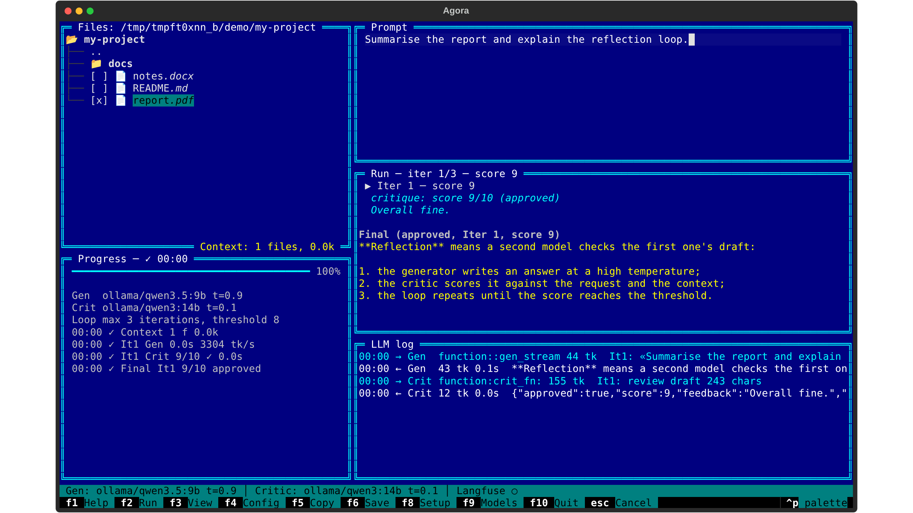
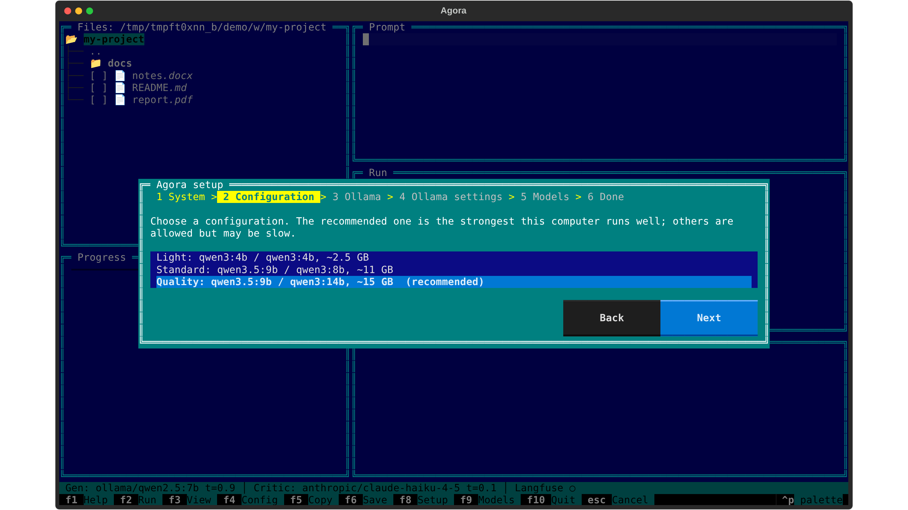
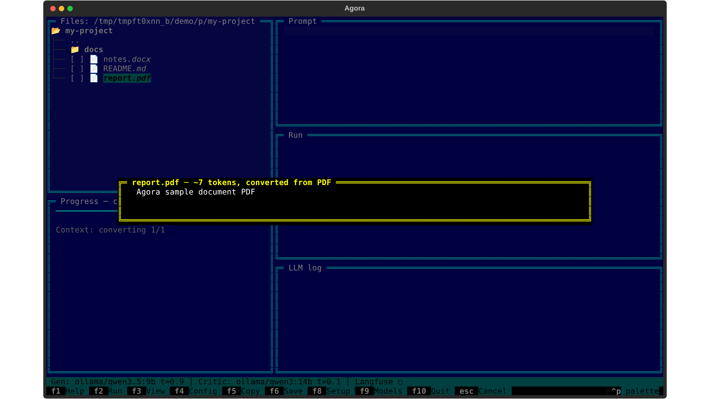

# Agora

**A reflection agent in a Far Manager-style console.** One local model drafts an answer, a second one critiques it, and the loop repeats until the critique is good enough. Your own documents (PDF, Word, PowerPoint, Excel, HTML) go into the context with a keystroke. Everything runs locally on [Ollama](https://ollama.com) by default.



Agora is the agentic module of the Appa platform.

## Features

- **Reflection loop.** A high-temperature generator and a low-temperature critic. The critic returns a structured verdict (score, issues, suggestions). Iterations stop at the approval threshold; otherwise the best-scored draft wins.
- **Your documents as context.** Mark files in the panel. PDF, DOCX, PPTX, XLSX and HTML are converted to Markdown, and `Enter` shows exactly what will be sent.
- **Local by default.** Ollama models with no data leaving the machine. Anthropic, OpenAI and OpenRouter are optional.
- **Setup wizard.** It checks the computer (RAM, GPU, disk), recommends a configuration, installs Ollama and downloads the models.
- **Transparent.** Live progress, a colour-coded LLM request log, and optional Langfuse tracing.

## Install (Windows)

1. Download `Agora-Setup-x.y.z.exe` from [Releases](https://github.com/cucumber405d/agora/releases) and run it. No administrator rights are needed.
   *The installer is not code-signed, so Windows SmartScreen says "Windows protected your PC". Click **More info → Run anyway**.*
2. Start **Agora** from the Start menu. The setup wizard opens on the first start:



A portable zip is attached to every release as well.

## Run from source (Windows, Linux, macOS)

```bash
uv sync
uv run agora            # first start opens the setup wizard
uv run agora doctor     # diagnostics in the console
```

Details: [quick start](docs/start.md).

## Keys

| Key | Action |
|---|---|
| `F1` | Help and version |
| `F2` / `Ctrl+Enter` | Run the reflection loop |
| `F3` | View the final answer |
| `F4` | Show the configuration |
| `F5` / `F6` | Copy / save the result |
| `F8` | Setup wizard |
| `F9` | Switch models for this session |
| `F10` | Quit |
| `Space` / `Ins` | Mark a file for the context |
| `Enter` on a file | Preview the text that will be sent |
| `Esc` | Cancel the run or close a dialog |



## Documentation

- [User guide](docs/user-guide.md)
- [Configuration](docs/configuration.md)
- [Architecture](docs/architecture.md)
- [Troubleshooting](docs/troubleshooting.md)
- [Change impacts](docs/impacts/) (RU/EN)

## Tech stack

Python 3.12, Pydantic AI, LangGraph, Textual, pydantic-settings, markitdown, httpx, Langfuse; uv, ruff, mypy (strict), pytest with Textual snapshots; PyInstaller and Inno Setup for Windows releases.
